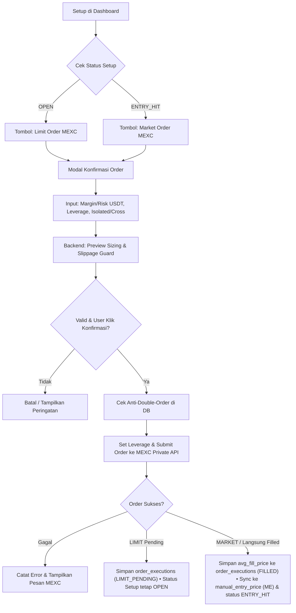

# Rencana Implementasi Action Order via MEXC Futures API

Dokumen ini merangkum gambaran alur, persiapan teknis, rancangan arsitektur, dan checklist pengamanan untuk fitur **eksekusi order langsung ke MEXC Futures** dari Trade Setup di **MEXC AI Setup Scanner**.

---

## 1. Tujuan & Konsep Action Order

Menambahkan tombol aksi langsung pada setiap setup yang aktif agar eksekusi order tidak perlu input manual di aplikasi MEXC:

- **Status `OPEN` (harga belum menyentuh Entry)** → Tombol **`Limit Order MEXC`**
  - Memasang **Limit Order** pada `entry_price` setup (atau `manual_entry_price` jika ada) beserta `stopLossPrice` dan `takeProfitPrice`.
- **Status `ENTRY_HIT` (harga sudah menyentuh zona Entry)** → Tombol **`Market Order MEXC`**
  - Mengeksekusi **Market Order** pada harga pasar saat itu disertai **Slippage Guard** agar tidak masuk jika harga sudah bergerak terlalu jauh dari rencana.
- **Status `EXTENDED`** → Mengikuti kondisi harga saat itu (Limit jika belum tersentuh, Market jika sudah di zona entry).
- **Order Pending (`LIMIT` belum terisi)** → Tombol **`Cancel Order MEXC`** untuk membatalkan order di MEXC.

---

## 2. Persiapan Sebelum Implementasi

### A. Kredensial & Keamanan API Key MEXC
1. Buat API Key di akun MEXC dengan izin:
   - **Read / Account** (cek saldo & posisi)
   - **Futures Trade** (submit & cancel order)
   - **Jangan aktifkan Withdraw**.
2. **IP Whitelist:**
   - Dari `localhost` (IP rumah dinamis), API Key tanpa whitelist tetap bisa digunakan (perhatikan masa berlaku key dari MEXC).
   - Untuk keamanan lebih tinggi, arahkan request melalui `mexc_proxy_url` / VPS ber-IP statis dan whitelist IP tersebut di MEXC.
3. **Simpan Kredensial:**
   - Tambahkan `MEXC_API_KEY` dan `MEXC_API_SECRET` di `.env` (atau terenkripsi di `app_settings`). Jangan pernah kirim `api_secret` ke frontend atau log.

### B. Uji Koneksi Private API Terlebih Dahulu
Karena MEXC Futures API sempat memberlakukan pembatasan akses order pada akun/region tertentu, lakukan verifikasi awal sebelum membangun UI:
1. Tes endpoint baca saldo: `GET /api/v1/private/account/assets`
2. Tes endpoint detail kontrak (public): `GET /api/v1/contract/detail`
3. Tes 1× submit + cancel Limit Order ukuran minimum pada pair likuid (misal jauh dari harga pasar) untuk memastikan akun mendapat izin order API.

### C. Konfigurasi Jaringan (ISP Indonesia)
- Gunakan `mexc_base_url` (`https://contract.mexc.fm` atau `https://contract.mexc.com`) dan `mexc_proxy_url` yang sudah tersedia di menu **Settings** agar request private API juga melewati jalur yang sama.

---

## 3. Alur Eksekusi Order (End-to-End Flow)

### Aturan Guard per Tipe Order
1. **Limit Order (Setup `OPEN`):**
   - Pastikan harga saat ini (`last_price`) masih di sisi yang valid:
     - `LONG`: `last_price > stop_loss` dan `entry_price <= last_price` (jika harga sudah tembus ke bawah entry dan masih valid, sarankan Market atau Limit sesuai kondisi).
     - `SHORT`: `last_price < stop_loss` dan `entry_price >= last_price`.
2. **Market Order (Setup `ENTRY_HIT`):**
   - **Slippage Guard:** hitung deviasi `abs(last_price - entry_price) / entry_price`. Jika melebihi batas maksimal (misal `> 0.5%` atau `> 0.5x ATR14`) atau R:R aktual turun di bawah `1.2`, tampilkan peringatan keras / blokir eksekusi.

---

## 4. Perhitungan Position Sizing & Presisi Kontrak MEXC

MEXC Futures menggunakan satuan **jumlah kontrak (`vol`)**, bukan langsung USDT. Sebelum mengirim order, backend wajib membaca metadata kontrak dari `/api/v1/contract/detail`:
- `contractSize` (nilai 1 kontrak dalam koin dasar, misal `0.0001` BTC atau `1` DOGE)
- `priceUnit` / `priceScale` (kelipatan pembulatan harga untuk Entry, SL, TP)
- `volUnit`, `minVol`, `maxVol` (kelipatan & batas jumlah kontrak)
- `maxLeverage` (batas leverage maksimal pair)

### Dua Mode Sizing yang Disarankan
1. **Berdasarkan Risk per Trade (Direkomendasikan):**
   - User isi `Risk USDT` (misal `$10` jika kena SL).
   - `jarak_sl = abs(entry_price - stop_loss)`
   - `qty_coin = risk_usdt / jarak_sl`
   - `vol = floor_to_step(qty_coin / contractSize, volUnit)`
2. **Berdasarkan Margin & Leverage:**
   - User isi `Margin USDT` (misal `$20`) dan `Leverage` (misal `10x`).
   - `notional_usdt = margin_usdt * leverage`
   - `qty_coin = notional_usdt / entry_price`
   - `vol = floor_to_step(qty_coin / contractSize, volUnit)`

Semua harga (`entry_price`, `stop_loss`, `take_profit`) wajib dibulatkan ke kelipatan `priceUnit` kontrak sebelum dikirim ke MEXC agar tidak ditolak oleh API.

---

## 5. Rancangan Perubahan Kode & Database

### A. Database (`app/models.py` & `init_database.sql`)
**Status `trade_setups.status` tidak perlu diubah/ditambah** (tetap memakai 10 status yang sudah ada: `OPEN`, `ENTRY_HIT`, `EXTENDED`, `MANUAL_TAKEN`, `HIT_TP`, `HIT_SL`, dll).

Tambahkan tabel baru **`order_executions`** (relasi ke `trade_setups.id`) untuk menyimpan status order MEXC secara terpisah + harga eksekusi aktual:
- `id`, `setup_id` (FK ke `trade_setups.id`)
- `symbol`, `side` (`OPEN_LONG` / `OPEN_SHORT`)
- `order_type` (`LIMIT` / `MARKET`)
- `open_type` (`ISOLATED` / `CROSS`)
- `leverage`, `vol`, `margin_usdt`, `risk_usdt`
- `entry_price` *(harga rencana)*, `avg_fill_price` *(harga aktual terisi dari MEXC `dealAvgPrice`)*, `stop_loss`, `take_profit`
- `avg_close_price` *(harga aktual saat posisi ditutup di MEXC)*, `realized_pnl_usdt`, `fee_usdt`, `close_reason` (`TP_HIT`, `SL_HIT`, `MANUAL_CLOSE`, `LIQUIDATION`)
- `mexc_order_id` (String, indexed)
- `status` (`LIMIT_PENDING`, `FILLED`, `PARTIAL`, `CANCELED`, `CLOSED`, `FAILED`)
- `filled_at`, `closed_at`, `error_message`, `raw_response` (JSON)
- `created_at`, `updated_at`

#### Sinkronisasi Harga Aktual MEXC ke Setup (`ME / Entry Aktual`)
- **Saat `LIMIT` dikirim & masih pending (`LIMIT_PENDING`):** status `trade_setups` tetap `OPEN` (tidak dipaksa berubah), di UI muncul badge link order MEXC (`MEXC: LIMIT PENDING`).
- **Saat order `LIMIT` atau `MARKET` terisi (`FILLED`) di MEXC:**
  - Ambil `dealAvgPrice` / harga eksekusi aktual dari MEXC dan simpan ke `order_executions.avg_fill_price`.
  - Karena harga fill di MEXC sering sedikit berbeda dari `entry_price` AI, simpan juga harga aktual tersebut ke `trade_setups.manual_entry_price` (atau field `actual_entry_price`), lalu jika status setup masih `OPEN`/`EXTENDED`, ubah ke **`ENTRY_HIT`** (catat event di `status_history`: *"MEXC Order Filled @ {avg_fill_price}"*).
  - Di tabel, detail setup, dan `Kotak Setup`, tampilkan harga aktual tersebut seperti label **`ME` (Entry Aktual)** pada `MANUAL_TAKEN` sehingga terlihat jelas perbandingan antara **Entry Rencana (AI)** dan **Entry Aktual (MEXC)**.
- **Saat posisi ditutup di MEXC (`CLOSED`):**
  - Simpan `avg_close_price`, `realized_pnl_usdt`, `fee_usdt`, dan `close_reason` di `order_executions` (`status = CLOSED`).
  - Otomatis sinkronkan ke `trade_setups`: isi `resolved_price = avg_close_price`, `resolved_at = closed_at`, dan ubah status setup secara otomatis (`HIT_TP` jika `TP_HIT`, `HIT_SL` jika `SL_HIT`, atau `CLOSED_MANUAL_TP` / `CLOSED_MANUAL_CL` jika ditutup manual di MEXC).
  - Di UI detail setup, tampilkan **Perbandingan Rencana App vs Hasil Aktual MEXC** (Entry AI vs Entry Aktual `ME`, TP/SL Rencana vs Harga Close Aktual, serta Realized PnL & Fee).

### B. Backend Private Client (`app/scanner/mexc_private.py`)
Modul baru khusus endpoint terautentikasi MEXC Futures:
- Signing **HMAC-SHA256** (`ApiKey`, `Request-Time`, `Signature`, `Recv-Window`)
- `get_account_assets()` → cek saldo USDT tersedia
- `get_contract_detail(symbol)` → cache metadata `contractSize`, `priceUnit`, `volUnit`, `maxLeverage`
- `change_leverage(symbol, leverage, open_type)`
- `submit_order(...)` → `LIMIT` / `MARKET` dengan `stopLossPrice` & `takeProfitPrice`
- `cancel_order(order_id)` & `get_order(order_id)`

### C. Backend Endpoints (`app/web/dashboard.py` & `app/schemas.py`)
- `GET /api/mexc/account` → status koneksi API Key & saldo USDT tersedia
- `POST /api/setups/{setup_id}/order/preview` → hitung `vol`, estimasi margin, estimasi rugi SL, estimasi profit TP, dan cek slippage
- `POST /api/setups/{setup_id}/order` → validasi anti-double-order, eksekusi ke MEXC, simpan ke `order_executions`:
  - Jika `LIMIT` masih pending → `order_executions.status = LIMIT_PENDING`, `trade_setups.status` tetap `OPEN`.
  - Jika `MARKET` langsung terisi (`FILLED`) → simpan `avg_fill_price` ke `order_executions` & `trade_setups.manual_entry_price` (agar tampil sebagai **`ME` / Entry Aktual**), lalu set `trade_setups.status = ENTRY_HIT`.
- `POST /api/setups/{setup_id}/order/cancel` → batalkan order `LIMIT_PENDING` di MEXC

### D. Frontend (`frontend/index.html`, `frontend/app.js`, `frontend/styles.css`)
- **Tombol Aksi & Badge Status Order MEXC di Tabel & Detail Modal Setup:**
  - `OPEN` → tampilkan tombol **`Limit Order`**
  - `ENTRY_HIT` → tampilkan tombol **`Market Order`**
  - Jika ada `order_executions` terkait → tampilkan badge status MEXC terhubung (`MEXC: LIMIT PENDING`, `MEXC: FILLED`, `MEXC: MARKET FILLED`, atau `MEXC: CLOSED`) + tombol **`Cancel Order`** bila masih `LIMIT_PENDING`.
  - Saat order sudah `FILLED`, tampilkan harga fill aktual MEXC sebagai **`ME` (Entry Aktual)** tepat di samping harga Entry rencana AI (seperti tampilan `MANUAL_TAKEN`).
- **Modal Konfirmasi Order MEXC:**
  - Pilih mode sizing (**Risk USDT** atau **Margin USDT**), **Leverage**, **Isolated / Cross**.
  - Tampilkan preview hasil hitungan backend: jumlah kontrak (`vol`), estimasi Margin terpakai, potensi rugi di SL, potensi profit di TP, R:R aktual, dan peringatan jika slippage melebihi batas.
  - Tombol **Konfirmasi & Kirim Order** hanya aktif setelah preview valid.

---

## 6. Checklist Implementasi Bertahap

- [ ] **Fase 1 (Verifikasi API):** Buat `app/scanner/mexc_private.py` dan endpoint `GET /api/mexc/account`, lalu uji saldo & izin order MEXC dari `localhost`.
- [ ] **Fase 2 (Sizing & Preview):** Implementasikan `get_contract_detail` + kalkulator `vol` & `priceUnit` + endpoint `POST /api/setups/{id}/order/preview`.
- [ ] **Fase 3 (Eksekusi & Audit):** Tambah tabel `order_executions`, endpoint `POST /api/setups/{id}/order` & `cancel`, serta guard anti-double-order + slippage guard.
- [ ] **Fase 4 (UI Modal & Tombol):** Tambah tombol `Limit Order` / `Market Order` sesuai status setup dan modal konfirmasi dengan preview sizing.
- [ ] **Fase 5 (Sinkronisasi Tracker, Auto-Close & Perbandingan Aktual):** Tracker periodik mengecek status order/posisi di MEXC; saat terisi (`FILLED`), simpan `avg_fill_price` ke `manual_entry_price` (tampil sebagai **`ME`**) dan ubah `OPEN` → `ENTRY_HIT`; saat tertutup di MEXC, simpan `avg_close_price` & `realized_pnl_usdt` lalu sinkronkan otomatis `resolved_price` & status setup (`HIT_TP`/`HIT_SL`/`CLOSED_MANUAL_*`) lengkap dengan perbandingan rencana vs hasil aktual MEXC.
